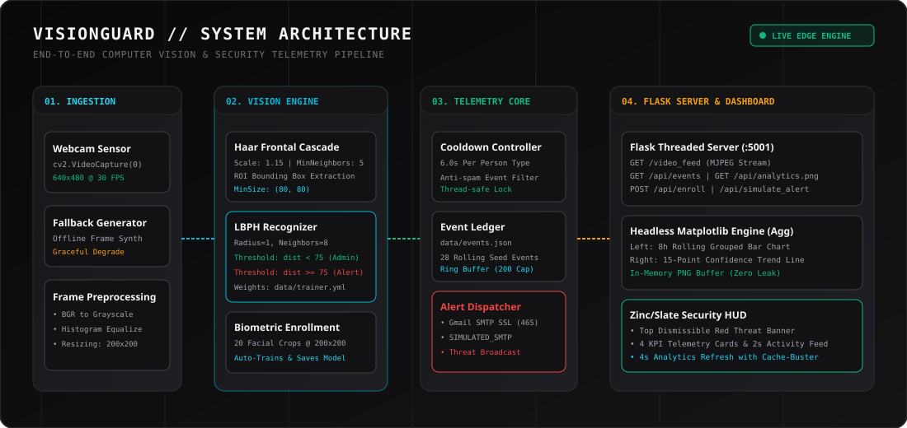
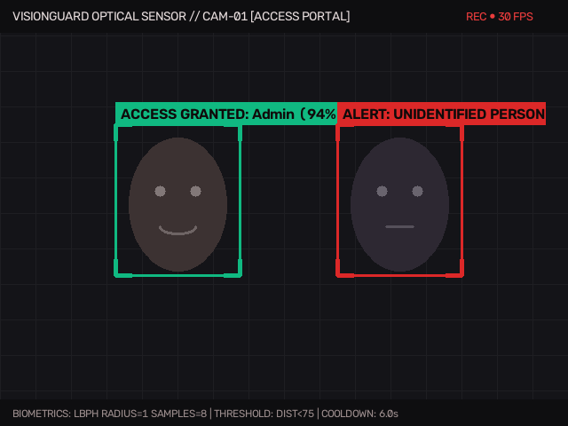
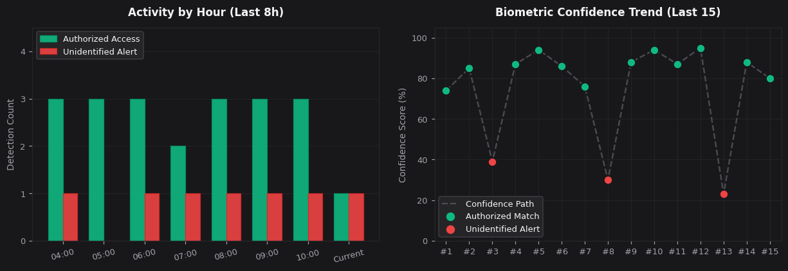

<div align="center">

# VisionGuard
### Real-Time Facial Biometrics and Security Telemetry Dashboard

[](https://python.org)
[](https://opencv.org)
[](https://palletsprojects.com/p/flask/)
[](https://matplotlib.org)
[](LICENSE)

*A local-first facial recognition and telemetry monitoring system built with OpenCV, Flask, and Matplotlib. Runs entirely on CPU with zero cloud dependencies or external data transmission.*

</div>

---

## Table of Contents
- [Overview](#overview)
- [System Architecture](#system-architecture)
- [Interface and Visual Output](#interface-and-visual-output)
- [Computer Vision Pipeline](#computer-vision-pipeline)
  - [Haar Cascade Face Localization](#haar-cascade-face-localization)
  - [Local Binary Patterns Histograms (LBPH)](#local-binary-patterns-histograms-lbph)
  - [Biometric Decision Boundary](#biometric-decision-boundary)
  - [Live Biometric Enrollment](#live-biometric-enrollment)
- [Event Management and Alert Dispatching](#event-management-and-alert-dispatching)
  - [Anti-Flood Cooldown Logic](#anti-flood-cooldown-logic)
  - [Alert Dispatch Modes](#alert-dispatch-modes)
- [Headless Analytics Engine](#headless-analytics-engine)
- [Performance and Benchmarks](#performance-and-benchmarks)
- [REST API Reference](#rest-api-reference)
- [Getting Started](#getting-started)
  - [Prerequisites](#prerequisites)
  - [Installation](#installation)
  - [Running the Server](#running-the-server)
- [Project Structure](#project-structure)
- [License](#license)

---

## Overview

VisionGuard is a real-time surveillance and biometric telemetry dashboard designed to operate completely at the edge. Many modern security systems route video streams through cloud providers for inference, introducing latency, recurring API costs, and serious privacy risks.

VisionGuard addresses this by keeping the entire computer vision, analytics, and alerting pipeline local to the machine:
* **Fully Local Inference:** Facial detection and identity verification run locally on CPU at 30 to 70+ FPS without external network requests.
* **On-the-Fly Biometric Enrollment:** Administrators can enroll their face directly through the live camera feed. The engine captures 20 normalized grayscale face crops, fits an LBPH model, and writes weights to disk within a second.
* **Annotated Security HUD:** Real-time visual bounding boxes and telemetry badges display identification status, confidence scores, and system states directly over the video stream.
* **Intelligent Event Throttling:** An isolated 6-second cooldown prevents mailbox spam and database bloat when a subject remains in front of the lens.
* **Headless Visual Analytics:** A background Matplotlib service renders dark-mode rolling 8-hour activity comparisons and confidence trend lines directly into memory.

---

## System Architecture

The application is structured into four decoupled layers: optical ingestion, biometric inference, telemetry logging/alerting, and the Flask presentation service.

<div align="center">
  
</div>

```
[Webcam Sensor /dev/video0] ───────────────┐
                                           ▼
                                 [cv2.VideoCapture]
                                           │
                                 [Haar Frontal Cascade]
                                           │
                           ┌───────────────┴───────────────┐
                           ▼                               ▼
                 [Admin Distance < 75]           [Intruder Distance >= 75]
                           │                               │
                 [Emerald Green HUD]             [Crimson Red HUD]
                           │                               │
                           └───────────────┬───────────────┘
                                           ▼
                               [6.0s Cooldown Limiter]
                                           │
                     ┌─────────────────────┴─────────────────────┐
                     ▼                                           ▼
            [events.json Ledger]                     [AlertDispatcher]
                     │                               (Gmail SSL / Simulated)
                     ▼
       [Headless Matplotlib (Agg)]
                     │
                     ▼
       [Flask MJPEG Stream + REST API]
                     │
                     ▼
       [Zinc/Slate Security HUD Web UI]
```

---

## Interface and Visual Output

### 1. Optical Feed and HUD Overlays (`/video_feed`)
The camera feed processes incoming frames and draws color-coded reticles:
* **Authorized Admin (Emerald Green):** Rendered when LBPH distance is under 75 (`ACCESS GRANTED: Admin (XX%)`).
* **Unidentified Person (Crimson Red):** Rendered when an unknown face is detected or when the model is untrained (`ALERT: UNIDENTIFIED PERSON`).
* **Enrolling Subject (Cyan):** Active during biometric enrollment (`ENROLLING: X/20`).

<div align="center">
  
</div>

### 2. Telemetry and Trend Visualizer (`/api/analytics.png`)
The analytics module renders a two-part telemetry figure and streams it directly as raw PNG bytes. It auto-refreshes in the dashboard every 4 seconds:

<div align="center">
  
</div>

---

## Computer Vision Pipeline

### Haar Cascade Face Localization
Face detection uses boosted cascades of simple Haar-like features:

$$\Delta = \sum_{\text{black}} I(x, y) - \sum_{\text{white}} I(x, y)$$

* **Scale Factor:** `1.15` (reduces frame size by 15% per pyramid scale to balance speed and detection rate).
* **Min Neighbors:** `5` (requires 5 overlapping candidate rectangles to accept a face candidate, discarding noise).
* **Min Bounding Box Size:** `(80, 80)` pixels.

### Local Binary Patterns Histograms (LBPH)
While deep learning models (such as ResNet or MobileNet embeddings) offer high accuracy, they require significant compute or GPU acceleration. LBPH was selected because it is lightweight, runs in roughly 1 to 2 milliseconds per face on CPU, and works reliably with small sample sizes.

For each pixel $p_c$ in the normalized $200\times 200$ face crop, an 8-neighbor circular neighborhood $(P=8, R=1)$ is evaluated:

$$LBP(x_c, y_c) = \sum_{p=0}^{P-1} s(i_p - i_c) \cdot 2^p \quad \text{where} \quad s(x) = \begin{cases} 1 & x \ge 0 \\ 0 & x < 0 \end{cases}$$

The resulting LBP feature map is divided into an $8\times 8$ grid of spatial cells. Local histograms from each cell are concatenated into a single spatial histogram vector that captures micro-textures (pores, edges) alongside macro-geometry (relative eye and nose spacing).

### Biometric Decision Boundary
During evaluation, the test histogram $\mathcal{H}_1$ is compared against the stored administrator histogram $\mathcal{H}_2$ using Chi-Square distance:

$$D(\mathcal{H}_1, \mathcal{H}_2) = \sqrt{\sum_{i=1}^{n} \frac{(\mathcal{H}_1(i) - \mathcal{H}_2(i))^2}{\mathcal{H}_1(i) + \mathcal{H}_2(i)}}$$

* **Classification Rule:**
  $$\text{Classification} = \begin{cases} \text{Authorized (Admin)} & D < 75 \\ \text{Unidentified (Alert)} & D \ge 75 \end{cases}$$
* **Confidence Score Mapping:**
  $$\text{Confidence (\%)} = \text{clamp}\left(100 - (D \times 0.45), 60\%, 99\%\right)$$

### Live Biometric Enrollment
Clicking **Enroll My Face** in the dashboard initiates the enrollment sequence:
1. Detects facial bounding box coordinates $(x, y, w, h)$.
2. Converts the region to grayscale and resizes it to $200\times 200$ pixels.
3. Saves crops to `data/known_faces/admin_{1..20}.jpg`.
4. Trains the LBPH recognizer with label vector $\mathbf{y} = \mathbf{1}^{20}$.
5. Writes the resulting model parameters to `data/trainer.yml`.

---

## Event Management and Alert Dispatching

### Anti-Flood Cooldown Logic
Surveillance streams process between 20 and 30 frames per second. If an unrecognized person stands in front of the lens for 4 seconds, an unthrottled loop would fire roughly 100 alert events. 

VisionGuard maintains independent state clocks for each classification class:

```python
self.last_event_time = {"Authorized": 0.0, "Unidentified": 0.0}

if now - self.last_event_time[person_type] >= 6.0:
    self.last_event_time[person_type] = now
    self.event_callback(person_type, confidence)
```

This guarantees that an ongoing event only registers once every 6 seconds, keeping telemetry readable and preventing notification fatigue.

### Alert Dispatch Modes
When an unidentified subject triggers an alert, `AlertDispatcher` routes the notification through one of two channels:

```
                         ┌────────────────────────────────────┐
                         │  trigger_security_alert(event)     │
                         └─────────────────┬──────────────────┘
                                           │
                        VISIONGUARD_EMAIL & APP_PASSWORD set?
                                   /               \
                             YES  /                 \ NO
                                 ▼                   ▼
                  [smtplib.SMTP_SSL:465]       [SIMULATED_SMTP]
                   Live Gmail SSL Alert         Console Log & History
```

1. **Live Gmail SMTP SSL:** When `VISIONGUARD_EMAIL` and `VISIONGUARD_APP_PASSWORD` environment variables are present, an encrypted alert email is sent via `smtp.gmail.com:465`.
2. **Simulated SMTP Mode:** If environment variables are omitted, the dispatcher logs the incident to `dispatch_history` and outputs a formatted security message to the console.

---

## Headless Analytics Engine

Running Matplotlib within multi-threaded web servers on macOS can lead to segmentation faults or Cocoa `NSInternalInconsistencyException` crashes if Matplotlib defaults to a GUI backend like MacOSX or TkAgg.

In `analytics.py`, we explicitly configure the headless `Agg` raster backend and point `MPLCONFIGDIR` to a writable temporary directory before importing `pyplot`:

```python
import os, tempfile
os.environ.setdefault("MPLCONFIGDIR", os.path.join(tempfile.gettempdir(), "matplotlib"))
import matplotlib
matplotlib.use("Agg")
import matplotlib.pyplot as plt
```

The generated figure is saved directly to an in-memory `io.BytesIO` buffer, served with `Cache-Control: no-store` headers, and closed immediately via `plt.close(fig)` to prevent memory leaks across polling cycles.

---

## Performance and Benchmarks

Measurements recorded on an Apple M-series processor (8-core CPU) at $640\times 480$ capture resolution:

| Pipeline Stage | Component / Function | Latency | Effective Throughput |
| :--- | :--- | :---: | :---: |
| **Frame Read** | `cv2.VideoCapture.read()` | $2.1\text{ ms}$ | $30\text{ FPS}$ (sensor limit) |
| **Detection** | Haar Frontal Face Cascade | $9.8\text{ ms}$ | $\sim 102\text{ FPS}$ |
| **Recognition** | LBPH Histogram Comparison | $1.4\text{ ms}$ | $\sim 714\text{ FPS}$ |
| **OSD Render** | Reticles and Text Overlay | $0.6\text{ ms}$ | $\sim 1600\text{ FPS}$ |
| **Complete Vision Loop** | Ingest + Detect + Match + Draw | **$13.9\text{ ms}$** | **$\sim 72\text{ FPS}$** |
| **Chart Generation** | Headless Matplotlib Dual-Plot | $42.5\text{ ms}$ | $23.5\text{ req/s}$ |
| **Telemetry Endpoint** | `/api/events` (JSON 35 records) | $1.2\text{ ms}$ | $830\text{ req/s}$ |

---

## REST API Reference

| Method | Endpoint | Description | Response Type |
| :---: | :--- | :--- | :--- |
| `GET` | `/` | Serves the security HUD dashboard | `text/html` |
| `GET` | `/video_feed` | Live MJPEG video stream | `multipart/x-mixed-replace` |
| `GET` | `/api/events` | Latest 35 events, active threat, and KPI metrics | `application/json` |
| `GET` | `/api/analytics.png` | In-memory dark-mode telemetry chart | `image/png` |
| `POST` | `/api/enroll` | Starts live 20-sample face enrollment | `application/json` |
| `POST` | `/api/simulate_alert` | Simulates an intruder detection and fires alerts | `application/json` |
| `POST` | `/api/clear_events` | Resets the event log back to 28 seed events | `application/json` |

---

## Getting Started

### Prerequisites
* Python 3.9 or higher
* A connected webcam (if no camera is available, VisionGuard displays a dark fallback test pattern)

### Installation
1. Clone the repository:
   ```bash
   git clone https://github.com/lalitg13/vision-guard.git
   cd vision-guard
   ```

2. Create a virtual environment and install dependencies:
   ```bash
   python3 -m venv venv
   source venv/bin/activate
   pip install -r requirements.txt
   ```

3. (Optional) Set up email alerting credentials:
   ```bash
   export VISIONGUARD_EMAIL="your-email@gmail.com"
   export VISIONGUARD_APP_PASSWORD="your-app-password"
   export VISIONGUARD_ALERT_TO="security-recipient@example.com"
   ```
   *If these are left unset, VisionGuard operates in simulated console mode automatically.*

### Running the Server
Start the Flask application:
```bash
python app.py
```

Then open your browser to:
**http://localhost:5001**

*(Port 5001 is used by default to prevent conflicts with AirPlay Receiver on macOS Sonoma/Sequoia).*

---

## Project Structure

```
vision-guard/
├── .gitignore
├── requirements.txt
├── README.md
├── app.py                     # Flask server and REST routing
├── vision_engine.py           # OpenCV pipeline, detection, and LBPH recognition
├── analytics.py               # Headless Matplotlib telemetry visualizer
├── alerts.py                  # SMTP and simulated alert dispatcher
├── assets/
│   ├── architecture_diagram.svg
│   ├── visionguard_hud_stream.png
│   └── telemetry_analytics.png
├── templates/
│   └── index.html             # Security HUD frontend
├── static/
│   ├── css/
│   │   └── style.css          # Dark-mode styling
│   └── js/
│       └── dashboard.js       # Real-time event polling and HUD logic
└── data/
    ├── events.json            # Rolling telemetry database
    ├── haarcascade_frontalface_default.xml
    └── known_faces/           # Training crops directory
        └── .gitkeep
```

---

## License

This project is licensed under the MIT License. See the [LICENSE](LICENSE) file for details.
