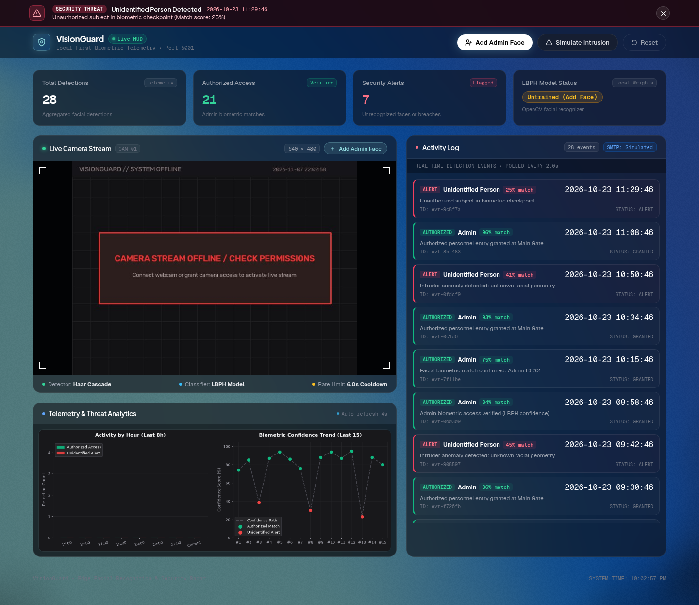
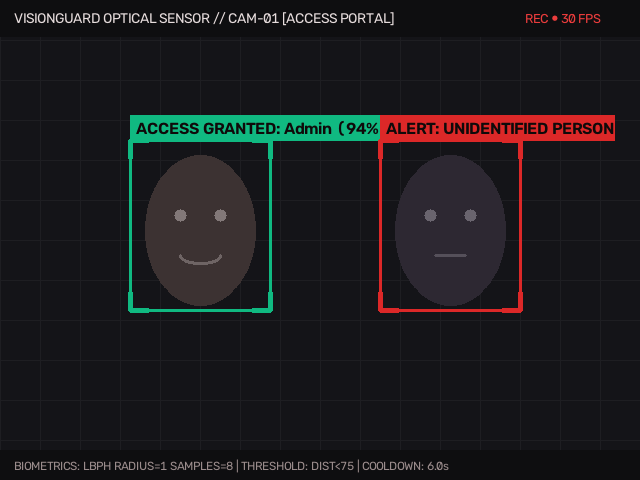
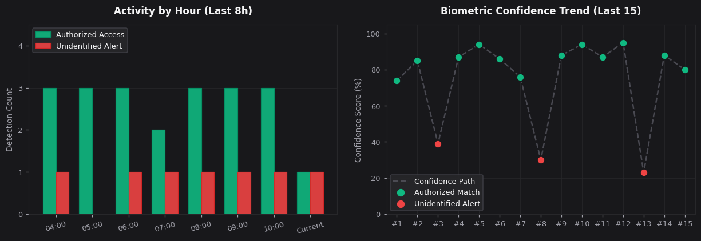
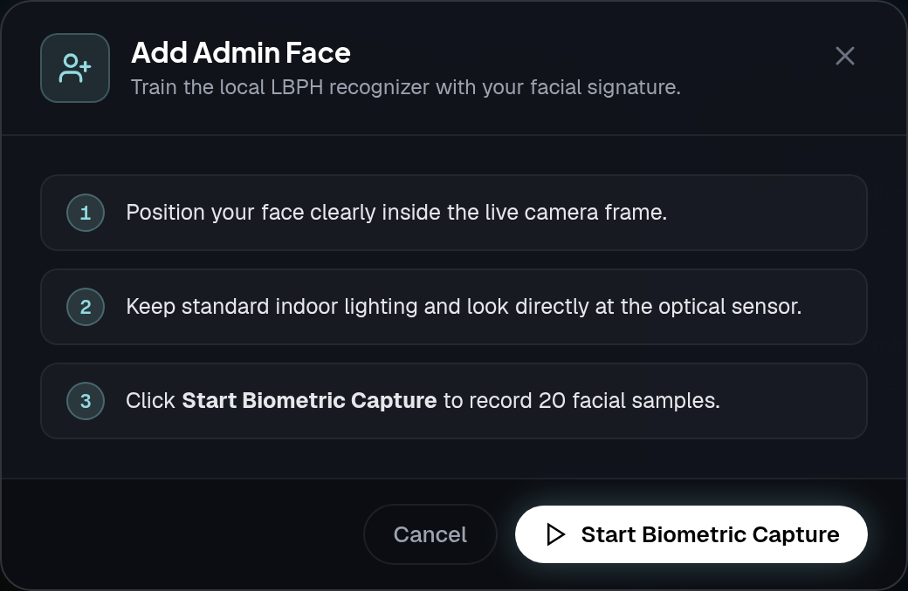
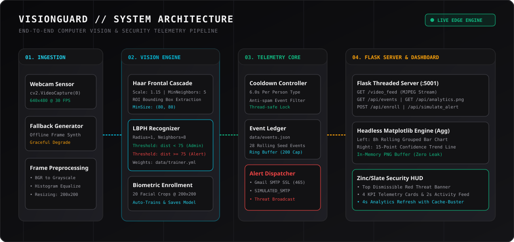

<div align="center">

# VisionGuard

A local-first face recognition and security dashboard. The webcam frame, the face model, the event log, and the charts all stay on the computer running the app.

[](https://python.org)
[](https://opencv.org)
[](https://palletsprojects.com/p/flask/)
[](https://matplotlib.org)
[](LICENSE)

`python app.py` → open **http://localhost:5001**

</div>

## See it

Dashboard captured with no webcam connected. The video panel is the offline frame drawn by `vision_engine.py`, and the text on that frame is `CAMERA STREAM OFFLINE / CHECK PERMISSIONS`. The summary cards, threat banner, activity log, and chart are filled from `data/events.json`, which ships with the repo as generated sample history.



The vision engine draws a badge on each detected face. Green means the LBPH distance is under 75 (`ACCESS GRANTED: Admin`). Red means the face is unknown, or the model has not been trained yet (`ALERT: UNIDENTIFIED PERSON`). Cyan is used while enrollment crops are being captured (`ENROLLING: N/20`). The picture below is a layout sample of those badges: the labels and colors match the engine, and the faces are placeholders.



`analytics.py` draws this two-panel figure in memory. The dashboard asks for a new copy every 4 seconds. The left panel is hourly counts over the last 8 hours. The right panel is a confidence series of up to 15 events. This file is a sample of that figure.



## Contents

- [Why this app exists](#why-this-app-exists)
- [What you can do in the dashboard](#what-you-can-do-in-the-dashboard)
- [Haar face detection](#haar-face-detection)
- [LBPH recognition and the distance-75 rule](#lbph-recognition-and-the-distance-75-rule)
- [Enrollment of 20 crops](#enrollment-of-20-crops)
- [Six-second alert cooldown](#six-second-alert-cooldown)
- [Event log](#event-log)
- [Optional Gmail alerts and simulated alerts](#optional-gmail-alerts-and-simulated-alerts)
- [Headless Matplotlib telemetry](#headless-matplotlib-telemetry)
- [Architecture and data flow](#architecture-and-data-flow)
- [REST API](#rest-api)
- [Project structure](#project-structure)
- [Install and run](#install-and-run)
- [License](#license)

## Why this app exists

VisionGuard is a student portfolio project that puts a whole security-dashboard loop in one local Python process.

A lot of face APIs want the picture uploaded, then return a name from someone else's servers. This app takes the other path. `app.py` starts a Flask server. `vision_engine.py` opens the webcam, finds faces, and compares them to one enrolled admin. Matches and unidentified faces are written to `data/events.json` on disk. `analytics.py` turns that file's rows into a chart. `alerts.py` can email an unidentified event through Gmail, or print the same alert in the terminal when no mail account is configured.

The point of the project is to show that pipeline end to end: capture, detect, recognize, draw a result on the frame, log it, chart it, and optionally notify. It is one admin, one classical model, and a dashboard you can click through. The log that ships in the repository is generated sample text so the page is populated before anyone enrolls a face.

Camera frames stay in this process. They are encoded as JPEG only to paint the `` on the local page. The HTML does load Geist, Geist Mono, and Plus Jakarta Sans from Google Fonts. The animated background is a WebGL shader in `static/js/shader-canvas.js` and does not call out to a network.

## What you can do in the dashboard

The page at `/` is `templates/index.html`. `static/js/dashboard.js` polls `GET /api/events` every 2 seconds and replaces the chart image every 4 seconds with `GET /api/analytics.png?t=...` so the browser does not reuse a cached PNG.

Four summary cards read `stats` from that poll:

| Card | Source |
| :--- | :--- |
| Total Detections | `stats.total_events`, the full length of the in-memory list |
| Authorized Access | rows whose `type` is `Authorized` or whose `status` is `GRANTED` |
| Security Alerts | rows whose `type` is `Alert` or whose `status` is `ALERT` |
| LBPH Model Status | `Trained (LBPH Active)` when `data/trainer.yml` loaded, otherwise `Untrained (Add Face)` |

The activity list renders the newest 35 rows. Each row shows a tag (`AUTHORIZED` or `ALERT`), the person name, a match percentage, the timestamp, the detail string, the event id, and the status. The small badge in the panel header counts how many rows came back in that response (at most 35), while the Total Detections card counts the whole file.

If the newest alert id changes, a banner appears at the top: person name, timestamp, detail text, and match score. Dismiss hides that id until a different alert arrives. **Reset** clears the dismissed id, hides the banner, and the next poll can show the banner again for whatever alert is now first in the new sample log.

The camera panel is labeled `CAM-01` and `640 × 480`. That `640 × 480` label is written in the HTML. It matches the width and height the capture code requests from the webcam. The footer under the video names the three settings the engine actually uses: Haar Cascade, LBPH Model, and a 6.0s cooldown.

Three buttons sit in the header:

* **Add Admin Face** opens the enrollment dialog (also available on the camera panel).
* **Simulate Intrusion** sends `POST /api/simulate_alert`. That inserts one sample unidentified row and runs the alert dispatcher. It does not read the camera.
* **Reset** sends `POST /api/clear_events`. That replaces `data/events.json` with 28 newly generated sample rows and clears the in-memory email history.

## Haar face detection

Face finding is OpenCV's frontal Haar cascade, not a neural detector.

On startup `VisionEngine` loads `haarcascade_frontalface_default.xml` from OpenCV's `cv2.data.haarcascades` path. If that classifier comes back empty, it loads the copy stored at `data/haarcascade_frontalface_default.xml`. The repository includes that file so the detector still has a cascade when the package data path is missing.

For every camera frame the engine converts BGR to grayscale and calls `detectMultiScale` with the values in `process_frame`:

| Argument | Value in this repo | What it changes |
| :--- | :--- | :--- |
| `scaleFactor` | `1.15` | Each pass of the image pyramid is 15% smaller than the previous pass |
| `minNeighbors` | `5` | A box is kept when at least five overlapping detections agree |
| `minSize` | `(80, 80)` | Boxes smaller than 80×80 pixels are dropped |

There is no call to histogram equalization. The grayscale crop is resized to `200×200` and that array is what both enrollment and recognition use. A resize failure skips that box and continues with the next face.

The running code does not draw faces when the camera is missing. It draws the offline frame instead: a `640×480` grid, a top bar reading `VISIONGUARD // SYSTEM OFFLINE` plus the current time, and a red rectangle whose main line is `CAMERA STREAM OFFLINE / CHECK PERMISSIONS`.

## LBPH recognition and the distance-75 rule

Recognition uses `cv2.face.LBPHFaceRecognizer`, which is why `requirements.txt` asks for `opencv-contrib-python` rather than the base `opencv-python` package. LBPH (local binary patterns histograms) is a classical CPU method. This project trains it on one person.

```python
self.recognizer = cv2.face.LBPHFaceRecognizer_create()
```

The call passes no radius, neighbor count, or grid size, so OpenCV's default LBPH settings apply. After training, or after a successful `recognizer.read("data/trainer.yml")`, `model_trained` is true.

`predict` returns a label and a distance. The label is unpacked and never read. Every training label in this repo is `1`, and the decision rule does not look at it. The rule is only the distance:

* Distance under 75, and a model is loaded: authorized admin.
* Distance 75 or higher: unidentified.
* `predict` raises: the code sets the distance to `999`, which fails the `< 75` test, and the face is unidentified.
* No `trainer.yml` yet: the recognizer is skipped and every detected face is unidentified.

The percentage printed on a green badge is a display mapping of that distance. Lower distance produces a higher number. It is clamped into the 60–99 range:

```text
confidence = clamp(100 - (distance * 0.45), 60, 99)
```

At distance 0 the badge shows 99%. A distance just under 75 lands in the mid-60s. Unidentified faces from the live loop do not use this mapping. Those log rows store a fixed confidence of `32`. The red badge text is `ALERT: UNIDENTIFIED PERSON` and does not include a percentage.

Colors passed to the drawer are BGR tuples from `process_frame`:

| State | Badge text | BGR color |
| :--- | :--- | :--- |
| Authorized | `ACCESS GRANTED: Admin (NN%)` | `(129, 185, 16)` |
| Unidentified | `ALERT: UNIDENTIFIED PERSON` | `(40, 40, 220)` |
| Enrolling | `ENROLLING: N/20` | `(255, 255, 0)` |

`_draw_hud_box` strokes a rectangle of thickness 2 around the face, then draws corner brackets. Each bracket is `min(18, width/4, height/4)` pixels long and 3 pixels thick. A filled badge sits just above the box, with the label in a dark color so it stays readable on the bright fill.

Several faces in one frame are handled in order. The first face that passes a cooldown check stamps that class's clock, so a second face of the same class in the same frame does not write a second log row.

## Enrollment of 20 crops

Enrollment teaches the single admin identity from the live camera. It needs a webcam and a face the cascade can see. The buttons only open a dialog. **Start Biometric Capture** is what calls the server.



The dialog copy asks you to face the camera, use ordinary indoor light, and record 20 samples. After **Start Biometric Capture**:

1. The browser sends `POST /api/enroll`.
2. `start_enrollment` sets `is_enrolling`, zeroes the count, and clears the sample list. The target is `20`.
3. The dialog polls `GET /api/enroll_status` every 250ms and moves a progress bar from `count / target`.
4. On each camera frame, every detected face while `is_enrolling` is true is resized to `200×200`, written to `data/known_faces/admin_N.jpg`, and appended to the in-memory sample list. The HUD shows `ENROLLING: N/20`.
5. When the count reaches 20, `_finish_enrollment` builds a label array of ones (`np.ones`, dtype `int32`) and calls `recognizer.train`.
6. Weights are saved with `recognizer.write` when that method exists, otherwise `recognizer.save`, to `data/trainer.yml`.
7. The engine sets `model_trained` and clears `is_enrolling`, then calls the event callback directly with `person_type="Authorized"`, confidence `99`, and the detail string `Admin face enrolled successfully (20 samples trained)`. That callback does not pass through the 6-second cooldown.
8. The dialog treats the run as finished when enrollment is no longer active and either the model is trained or the count has reached the target. **Done** closes it and shows the toast `Administrator face enrolled successfully!`

`data/known_faces/*.jpg` and `data/trainer.yml` are listed in `.gitignore`. A fresh clone starts with `Untrained (Add Face)` until someone completes this flow. If `trainer.yml` is present but `recognizer.read` throws, the engine prints a warning and leaves `model_trained` false.

If no face is detected, the count stays at 0 and `is_enrolling` stays true. The dialog keeps polling until it is closed. Closing the dialog stops the browser poll. It does not send a cancel route to the server, so the engine flag stays set until 20 crops are collected or the process restarts.

## Six-second alert cooldown

The camera loop can see the same person on every frame. Logging each of those frames would fill `events.json` immediately. `VisionEngine` keeps two clocks:

```python
self.cooldown_seconds = 6.0
self.last_event_time = {"Authorized": 0.0, "Unidentified": 0.0}

if now - self.last_event_time[person_type] >= 6.0:
    self.last_event_time[person_type] = now
    self.event_callback(...)
```

The HUD is redrawn on every processed frame. The log row is written only when that class has been quiet for 6 seconds. Authorized and unidentified clocks are independent, so an admin match and an unidentified face can each log inside the same window.

When the authorized clock fires, the callback gets the mapped confidence and the detail `Admin verified via facial biometrics`. When the unidentified clock fires, the callback gets confidence `32` and the detail `Unidentified person detected in restricted area`.

`on_vision_event` in `app.py` turns that callback into a row and, for unidentified rows only, calls `AlertDispatcher`. An authorized match is logged and is not emailed.

**Simulate Intrusion** and the enrollment-success callback do not consult these clocks. Simulate always inserts a row. Enrollment success always inserts one authorized row.

## Event log

The log is a JSON list at `data/events.json`, guarded by `events_lock`. New rows are inserted at index 0, so the file stays newest-first. After each insert the list is trimmed to 200 rows by dropping the last item, then the whole list is written back with `json.dump(..., indent=2)`.

A live or enrollment row looks like this:

| Field | Value |
| :--- | :--- |
| `id` | `evt-` plus 6 hex characters from `uuid4` |
| `timestamp` | local time, `YYYY-MM-DD HH:MM:SS` |
| `type` | `Authorized` or `Alert` |
| `person` | `Admin` or `Unidentified Person` |
| `confidence` | integer |
| `details` | the string passed by the engine, or a short fallback |
| `status` | `GRANTED` or `ALERT` |

Startup calls `_load_or_seed_events`. A non-empty JSON list in `events.json` is used as-is. The copy in the repository is that kind of file: 28 generated rows, so the dashboard has a log, a banner, and chart input before a camera is attached. If the file is missing, empty, or not valid JSON, `_generate_seed_events` builds a new list of 28 rows and saves it.

Those generated rows are sample text. Seven of them (loop indexes 2, 7, 12, 17, 21, 25, and 27) are alerts with a confidence from 22 to 45 inclusive. The other 21 are authorized rows with a confidence from 72 to 97 inclusive. Timestamps are spread across the previous 8 hours with a few minutes of jitter, and the list is sorted newest-first. Detail strings are chosen from four authorized phrases and four alert phrases in `app.py`. They are not observations of real people.

**Reset** runs that generator again, overwrites the file, and clears `dispatch_history`. The new ids, times, and confidences are random, so a reset does not restore the exact bytes that were committed.

## Optional Gmail alerts and simulated alerts

`AlertDispatcher` runs only for unidentified events: a live unidentified detection that passed the cooldown, or **Simulate Intrusion**. Authorized rows never call it.

The dispatcher reads three environment variables:

| Variable | Role |
| :--- | :--- |
| `VISIONGUARD_EMAIL` | Gmail address used as SMTP username and as the From address |
| `VISIONGUARD_APP_PASSWORD` | Gmail app password. Both this and the email must be set, or mail is skipped |
| `VISIONGUARD_ALERT_TO` | Recipient. If unset, the sender is used. If the sender is also unset, the placeholder is `security-team@visionguard.local` |

When both secrets are set, the message is plain text sent with `smtplib.SMTP_SSL("smtp.gmail.com", 465)`. The subject is `[VisionGuard Alert] Unidentified Subject Detected` plus the confidence. The body includes the event id, timestamp, type `UNIDENTIFIED_PERSON`, confidence, and details. A successful send is stored in `dispatch_history` with `mode` `GMAIL_SMTP` and `status` `SENT`.

If either secret is missing, or if login or send raises, the same event is stored with `mode` `SIMULATED_SMTP` and `status` `DISPATCHED`, and a block is printed to the terminal. An SMTP exception falls through into that simulated record. It is not dropped.

`dispatch_history` lives in the process. It is not written to `events.json`. Restarting the app clears it. **Reset** clears it too.

The activity-panel badge reads that list. If any record has `mode` `GMAIL_SMTP`, the badge says `Gmail SMTP: Active`. Otherwise it says `SMTP: Simulated`, including on a fresh start before any alert has been sent.

## Headless Matplotlib telemetry

`analytics.py` sets the Matplotlib backend before importing `pyplot`:

```python
os.environ.setdefault("MPLCONFIGDIR", os.path.join(tempfile.gettempdir(), "visionguard_matplotlib"))
import matplotlib
matplotlib.use("Agg")
import matplotlib.pyplot as plt
```

`Agg` is a file backend, so the Flask process does not open a GUI window. `MPLCONFIGDIR` points at a writable temp directory because Matplotlib wants a config path of its own.

`GET /api/analytics.png` copies the event list under the lock and passes it to `generate_analytics_chart`. The figure is two panels, `figsize=(11.5, 4.2)`, saved to a `BytesIO` buffer as PNG at 110 dpi, then closed with `plt.close(fig)`. The response is `image/png` with `Cache-Control: no-cache, no-store, must-revalidate`. The browser still appends a timestamp query on refresh.

**Left panel, "Activity by Hour (Last 8h)".** Eight one-hour bins end at the current hour, which is labeled `Current`. Older bins are labeled with that hour, such as `14:00`. A row counts as authorized when its type contains `auth` or `admin`, or its status is `GRANTED`. Every other row in the window counts as an unidentified alert. Rows older than 8 hours are left out of the bars. A sample log whose timestamps are from a previous day will produce an empty-looking bar chart until new rows fall inside the window. The confidence panel does not use that 8-hour cutoff.

**Right panel, "Biometric Confidence Trend (Last 15)".** The code takes `events[:15]` when the list has 15 or fewer rows, and `events[-15:]` when it has more. New rows are inserted at the front, so once the log is longer than 15, `events[-15:]` is the oldest 15 rows. If the first timestamp in that slice is newer than the last, the slice is reversed so the line reads forward in time. Points are green for authorized rows and red for alerts. The x-axis labels are `#1` … `#N`. An empty list draws the text `No Telemetry Events Recorded`. A confidence value that cannot be parsed as a float is drawn as 50.

## Architecture and data flow



The diagram is the map of the pipeline. The steps below are the ones the Python files actually run.

```
Browser  ── GET / ──────────────►  templates/index.html + static/
        ── GET /video_feed ─────►  VisionEngine.generate_frames (MJPEG)
        ── GET /api/events ─────►  events list (newest 35) + stats
        ── GET /api/analytics.png ► analytics.generate_analytics_chart
        ── POST /api/enroll ────►  VisionEngine.start_enrollment
        ── POST /api/simulate_alert /api/clear_events

VisionEngine loop
    AVFoundation camera index 0, then 1, requested size 640×480
        │  retry every 2 seconds when no camera is open
        ▼
    frame or the 640×480 offline frame
        │
        ▼
    gray → Haar detectMultiScale → 200×200 crop
        │
        ├─ is_enrolling → save admin_N.jpg, cyan badge, train at 20
        ├─ model trained and distance < 75 → green badge
        └─ otherwise → red badge
                │
                ▼
        6.0s clock for that class (HUD still updates every frame)
                │
                ▼
        on_vision_event → insert row → data/events.json (max 200)
                │
                └─ unidentified only → AlertDispatcher
                       ├─ Gmail SMTP SSL :465
                       └─ or SIMULATED_SMTP printed to the terminal
```

`app.py` builds one `VisionEngine` and one `AlertDispatcher` at import time, then loads or seeds the event list before it serves traffic. Flask is started with `host="0.0.0.0"`, `port=5001`, `debug=True`, `use_reloader=False`, and `threaded=True`. The reloader is off so a second process does not open the camera. The vision loop and the request threads share `events_lock` for the JSON list and `VisionEngine.lock` for the capture device and enrollment flags.

Camera open is specific. `_init_camera` tries indexes 0 and 1 with `cv2.CAP_AVFOUNDATION`, which is the macOS backend, and keeps the device only if `read()` returns a frame. It then sets the requested frame size to 640×480. The size printed in the log is the test frame's actual shape, which can differ if the camera refuses that mode. If open or read fails, `cap` stays `None` and every MJPEG part is the offline frame. While offline, the generator sleeps 0.08 seconds between JPEGs so the loop does not spin. JPEG quality is 85. The multipart boundary is `frame`.

## REST API

| Method | Endpoint | Returns |
| :---: | :--- | :--- |
| `GET` | `/` | `text/html`. The dashboard template. |
| `GET` | `/video_feed` | `multipart/x-mixed-replace` MJPEG. Each part is `image/jpeg`. Frames are annotated camera images, or the offline frame when no camera frame is available. |
| `GET` | `/api/events` | JSON. `events` is the newest 35 rows. `latest_alert` is the first row in the full list with type `Alert` or status `ALERT`, or `null`. `dispatched_emails` is the in-memory dispatcher history. `stats` contains `total_events`, `alerts_count`, `authorized_count`, `model_trained`, `is_enrolling`, `enrollment_count`, and `target_samples` (20). |
| `GET` | `/api/analytics.png` | `image/png` drawn from the current event list. `Cache-Control` is `no-cache, no-store, must-revalidate`. |
| `POST` | `/api/enroll` | JSON: `status` `"enrolling"`, a message telling the operator to face the camera for 20 frames, and `target` (20). Starts capture. It does not wait for the 20 crops. |
| `GET` | `/api/enroll_status` | JSON: `is_enrolling`, `count`, `target`, `model_trained`. |
| `POST` | `/api/simulate_alert` | JSON: `status` `"ok"`, the inserted event, and the `dispatch` record (`GMAIL_SMTP` / `SENT` or `SIMULATED_SMTP` / `DISPATCHED`). The event uses confidence `random.randint(25, 46)` and the detail `Simulated security alert: Unidentified subject penetrated Zone B`. |
| `POST` | `/api/clear_events` | JSON: `status` `"ok"` and the message `Telemetry event log reset to fresh historical seed data.` Replaces the log with 28 new generated rows and clears email history. |

There is no request body on the POST routes. They ignore any JSON you attach.

## Project structure

```
vision-guard/
├── app.py                         # Flask routes, seed data, event log
├── vision_engine.py               # Camera, Haar, LBPH, HUD, MJPEG
├── analytics.py                   # Headless Matplotlib chart
├── alerts.py                      # Gmail SMTP SSL or simulated console alerts
├── requirements.txt               # Flask, opencv-contrib-python, matplotlib, numpy
├── README.md
├── LICENSE
├── .gitignore                     # venv, trainer.yml, known face jpgs
├── assets/
│   ├── dashboard_overview.png     # Dashboard captured with no webcam
│   ├── visionguard_hud_stream.png # HUD layout sample, placeholder faces
│   ├── telemetry_analytics.png    # Sample two-panel telemetry figure
│   ├── enroll_modal.png           # Add Admin Face dialog
│   └── architecture_diagram.svg   # Pipeline diagram
├── templates/
│   └── index.html                 # Dashboard markup
├── static/
│   ├── css/style.css
│   └── js/
│       ├── dashboard.js           # Polls, banner, enrollment dialog, buttons
│       └── shader-canvas.js       # Local WebGL background
└── data/
    ├── events.json                # Sample log shipped with the repo
    ├── haarcascade_frontalface_default.xml
    └── known_faces/               # Enrollment crops, jpg files gitignored
```

`data/trainer.yml` is created next to `events.json` after a successful enrollment and is gitignored.

## Install and run

### Prerequisites

* Python 3.9 or newer
* A webcam if you want live detection or enrollment. The open path uses AVFoundation and tries camera indexes 0 and 1, which is the macOS setup this code was written for. If `read()` never returns a frame, the server still starts and the video panel shows `CAMERA STREAM OFFLINE / CHECK PERMISSIONS`.

### Installation

1. Clone the repository:

   ```bash
   git clone https://github.com/lalitg13/vision-guard.git
   cd vision-guard
   ```

2. Create a virtual environment and install dependencies:

   ```bash
   python3 -m venv venv
   source venv/bin/activate
   pip install -r requirements.txt
   ```

   `requirements.txt` installs Flask 3.0 or newer, `opencv-contrib-python` 4.10 or newer (needed for `cv2.face`), Matplotlib 3.9 or newer, and NumPy 1.26 or newer.

3. Optional: turn on Gmail alerts. Leave these unset to keep simulated console alerts.

   ```bash
   export VISIONGUARD_EMAIL="your-email@gmail.com"
   export VISIONGUARD_APP_PASSWORD="your-app-password"
   export VISIONGUARD_ALERT_TO="security-recipient@example.com"
   ```

   `VISIONGUARD_APP_PASSWORD` is a Gmail app password, not the normal account password. The recipient defaults to `VISIONGUARD_EMAIL` when `VISIONGUARD_ALERT_TO` is omitted.

### Running the server

From the repository directory, with the virtual environment activated:

```bash
python app.py
```

Then open **http://localhost:5001**.

The process listens on `0.0.0.0:5001`. Port 5001 is the default so it does not collide with AirPlay Receiver on macOS. Debug mode is on and the auto-reloader is off.

On a machine with no camera you should see the offline video panel, summary cards filled from `data/events.json`, an activity list, and a chart. The model card stays `Untrained (Add Face)` until `data/trainer.yml` exists. **Simulate Intrusion** adds one alert row and prints the simulated alert in the terminal. **Reset** replaces the sample log.

To enroll an admin, use a Mac webcam the AVFoundation backend can open, click **Add Admin Face**, and complete 20 detected frames. The badge then reads `Trained (LBPH Active)`.

## License

This project is licensed under the MIT License. See [LICENSE](LICENSE).
